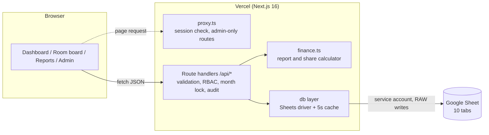

# Architecture

Partner Ledger is a Next.js 16 app on Vercel that uses one Google Sheet as its
database. Managers record what happens each day; the app turns that into a
monthly profit report and splits the profit between the operating partner and
the investors.



## Folder map

```
src/
  proxy.ts                 First gate: redirects signed-out users, keeps /admin admin-only
  app/
    login/                 Sign-in page
    (app)/                 Signed-in area (shared shell + nav)
      dashboard/           Portfolio overview for the month
      business/[id]/       Room board / daily income / expenses / report for one business
      reports/             Report for any business + month, print and CSV
      admin/users          Accounts and business access
      admin/businesses     Business details, rooms, manager %, investor split
      admin/audit          Change log with before/after
    api/                   JSON API (every route re-checks the session and role)
  lib/
    schema.ts              Tab names and header rows (the database schema)
    types.ts               Typed rows
    db/                    Driver interface, Google Sheets driver, local JSON driver
    auth/                  JWT session cookie (jose) + server helpers
    rbac.ts                Who can see/edit which business, month lock rule
    finance.ts             Pure calculation engine (no I/O)
    reports.ts             Loads data and runs the engine for reports/dashboard
    entries.ts             Shared create/update/soft-delete for bookings, income, expenses
    audit.ts               Writes AuditLog rows with a human-readable diff
    validation.ts          zod schemas for every input
  components/              UI (glass shell, room board, profit staircase, forms, admin)
scripts/
  setup.ts                 Creates tabs + headers, first admin, seeds starting data
  seed-data.ts             Businesses, Aura rooms, October 2026 bookings from the old sheet
```

## Google Sheet schema

Every tab has `id` in column A. The app reads and writes by header name, so
you can add columns to the right without breaking anything. Dates are stored
as text `YYYY-MM-DD`; money as plain numbers.

### Users
| Column | Meaning |
|---|---|
| id | `USR-…` |
| name, email, phone | Contact details; email is the login |
| password_hash | bcrypt hash, never the password |
| role | `ADMIN`, `PROPERTY` (business manager) or `USER` (shareholder, read-only) |
| status | `ACTIVE` or `DISABLED` (removed accounts are disabled, not deleted) |
| created_at, updated_at, last_login_at | ISO timestamps |

### Businesses
| Column | Meaning |
|---|---|
| id | `BIZ-…` |
| name, location, notes | |
| type | `RESORT`, `PHARMACY`, `INSTITUTE`, `OTHER` — decides the screens shown |
| status | `ACTIVE` or `ARCHIVED` |
| manager_share_pct | Operating partner's % of net profit (e.g. 30) |
| currency | `INR` |

### Units (rooms)
| Column | Meaning |
|---|---|
| id, business_id | |
| floor | 0 = ground, 1 = first, … (sorts the room board) |
| floor_label, name | "Ground floor", "Ground room" |
| base_rate | Usual nightly rate (optional, reference only) |
| status | `ACTIVE` / `INACTIVE` (never deleted, so old bookings keep their room) |
| sort | Display order |

### Assignments (who can access which business)
| Column | Meaning |
|---|---|
| user_id, business_id | |
| access | `MANAGE` for property managers, `VIEW` for shareholders |

### Shareholders (investor split)
| Column | Meaning |
|---|---|
| business_id | |
| user_id | Optional link to an account, so that person sees "Your share" |
| name | Name on the payout table |
| share_pct | % of the **investor pool**; active rows per business must total 100 |
| status | `ACTIVE` / `INACTIVE` |

### Bookings (resorts)
| Column | Meaning |
|---|---|
| business_id, unit_id | |
| guest_name, guest_phone | |
| check_in, check_out | `check_out` is the departure morning (exclusive) |
| nights | Calculated |
| amount | Total for the stay |
| channel | Direct, Airbnb, Booking.com, MakeMyTrip, Goibibo, Referral / contact, Owner / family, Other |
| remarks | Free text |
| is_deleted | Soft delete; removed rows stay for the audit trail |
| created_by/at, updated_by/at | Who and when |

### Income (daily takings for any business; "other income" for resorts)
`business_id, date, category, amount, description, is_deleted, created_*/updated_*`

Categories by type: pharmacy — Counter sales, Online orders, Other;
institute — Course fees, Registration, Workshop, Other; resort — Extra services, Food, Other.

### Expenses
`business_id, date, category, amount, description, paid_to, is_deleted, created_*/updated_*`

`category` is one of `RENT`, `SALARY`, `MAINTENANCE`, `OTHERS`.

### Periods (month lock)
`business_id, month (YYYY-MM), status (OPEN/LOCKED), locked_by, locked_at, note`

### AuditLog
| Column | Meaning |
|---|---|
| timestamp, user_id, user_name, role | Who |
| business_id, entity, entity_id | What |
| action | `CREATE`, `UPDATE`, `DELETE`, `LOCK`, `UNLOCK`, `LOGIN` |
| summary | Readable diff, e.g. `amount 6000 → 6500` |
| before_json, after_json | Full row before and after (password hashes stripped) |

## Access rules

| | Admin | Property manager | Shareholder |
|---|---|---|---|
| See businesses | All | Assigned (MANAGE) | Assigned (VIEW) + any where they're a linked investor |
| Add / edit / remove bookings, income, expenses | Yes, any month | Yes, open months only | No |
| See reports and payouts | All | Their businesses | Their businesses |
| Accounts, rooms, manager %, investor split | Yes | No | No |
| Lock / unlock a month | Yes | No | No |
| Change log | Yes | No | No |

Enforced in three places: `proxy.ts` (page redirects), each page's server
component, and — the one that matters — every API route via `rbac.ts`. The
session cookie is re-checked against the Users tab on each request, so
removing an account or changing its role takes effect immediately.

## Financial rules (`src/lib/finance.ts`)

1. A booking's full amount is revenue in the month of **check-in** (this is how
   the old sheet recorded it: amount on the first night).
2. Revenue = bookings checked in this month + income dated this month.
3. Expenses are grouped into Rent, Staff salary, Maintenance materials, Others.
4. Net profit = revenue − expenses.
5. If net profit > 0: manager share = net × manager_share_pct; investor pool =
   the rest; each investor gets pool × their share_pct.
6. If net profit ≤ 0: nothing is paid out; the report shows the loss. (Carrying
   losses forward is a policy choice — see "Next steps" in the README.)
7. Occupancy = room-nights booked inside the month ÷ (active rooms × days). Stays
   that cross month-end count their nights in each month.

October 2026 check against `AURA VASANTH OCT 26.xlsx`: Ground ₹45,856 + First
₹20,725 + Second ₹33,356 = ₹99,937, 34 of 93 room-nights. The setup script
refuses to finish if the migrated total doesn't match.

## Security notes

- Passwords: bcrypt (cost 10). Sessions: HS256 JWT in an httpOnly, SameSite=Lax,
  Secure cookie, 12-hour expiry.
- Sheet writes use `valueInputOption: RAW`, so text like `=IMPORTXML(...)` typed
  into a form is stored as text, never run as a formula.
- All input is validated with zod on the server; amounts can't be negative;
  bookings can't overlap in the same room.
- Login attempts are throttled per email (5 tries, then 1-minute wait).
- The service-account key lives only in Vercel environment variables. Only
  the service account (and you) should have edit access to the sheet —
  anyone who can edit the sheet directly bypasses the audit log.

## Limits of Google Sheets as a database

Fine for a handful of businesses and managers (thousands of rows). Watch for:

- **Quota**: 60 read requests per minute per service account by default. The
  5-second cache and batched reads keep normal use well under it.
- **Concurrency**: two people editing the same row at the same second — last
  write wins. Appends (new entries) are safe.
- **Size**: if the Bookings or AuditLog tab passes ~20,000 rows, archive old
  months to a second sheet or move to Postgres. The `Driver` interface in
  `src/lib/db/driver.ts` is the only thing that would change.
